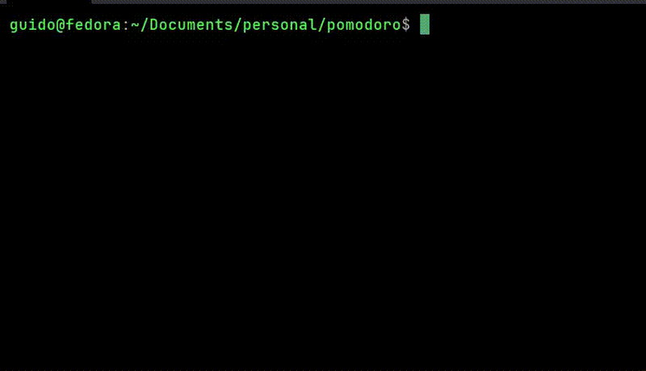
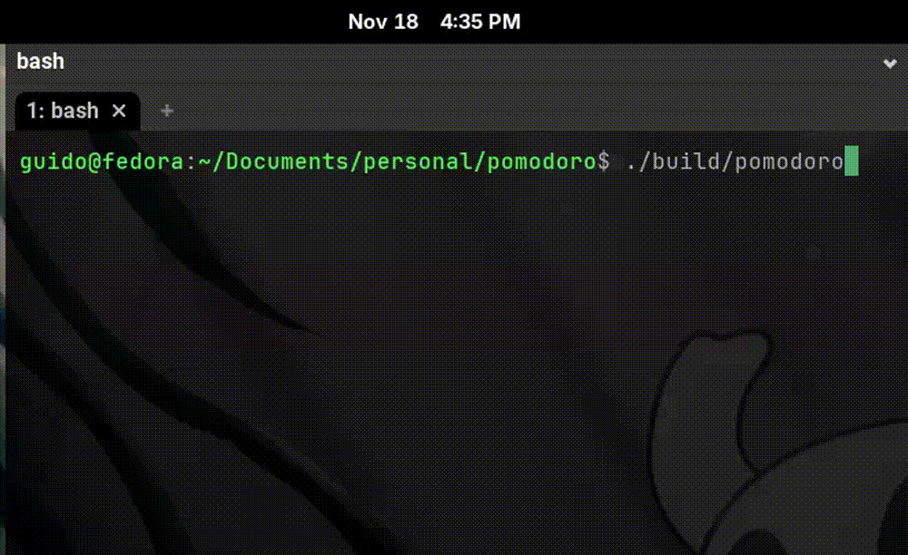

# Pomodoro CLI

A terminal-based Pomodoro timer written in C, using POSIX APIs.





## Features

- Focus, short break, and long break sessions
- Terminal-based user interface
- Pause and resume 
- Percentage indicator bar
- Sound notifications
- Desktop notifications

## Requirements

- Linux
- GCC (with C23 support)
- GNU Make
- `paplay` for sound notifications 
- `notify-send` for desktop notifications 

## Installation

Clone the repository:

```bash
git clone https://github.com/GuidoMr/pomodoro-cli.git
cd pomodoro-cli
```

Build the project:

```bash
make
```

The executable will be generated at `build/pomodoro`.

## Usage

Run the application:

```bash
./build/pomodoro
```

### Controls

| Key | Action                   |
| :-: | ------------------------ |
| `p` | Pause / resume the timer |
| `n` | Go to the next session   |
| `q` | Quit the application     |

## Running Tests

Run the test suite:

```bash
make test
```

The project includes tests for the timer and Pomodoro session logic.

## Project Structure

```text
.
├── assets/       # Sound file and demo GIFs
├── build/        # Compiled executable and tests
├── include/      # Header files
├── Makefile
├── README.md
├── src/          # Source files
└── tests/        # Unit tests
```

## Implementation Details

**The project is written in C and uses POSIX APIs for terminal input handling, process management, and signal handling.**

**Timekeeping:** Uses `clock_gettime()` with `CLOCK_MONOTONIC` to measure elapsed time independently of system clock adjustments.

**Process management:** Uses `fork()` and `execlp()` to run external programs for notifications (`paplay` and `notify-send`).

**Non-blocking notifications:** Runs notification tasks in child processes so the timer doesn't have to stop until they are done.

**Process lifecycle:** Handles child termination and reaping in the main loop without stopping the program, as well as on cleanup.

**Testing:** Includes unit tests covering timer and Pomodoro session logic.

## License

Distributed under the MIT License. See [LICENSE](LICENSE) for more information.

